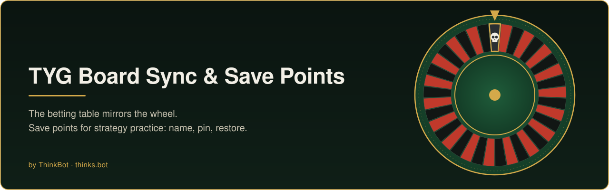
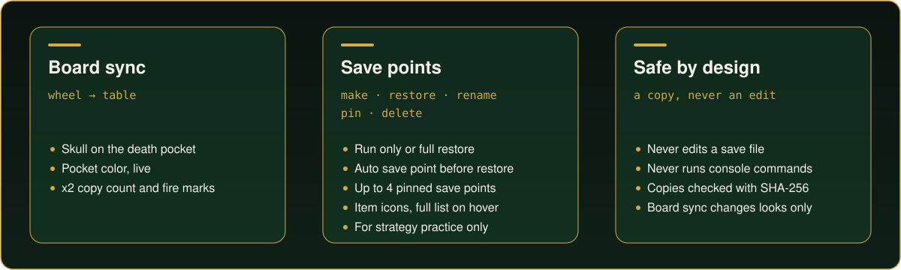
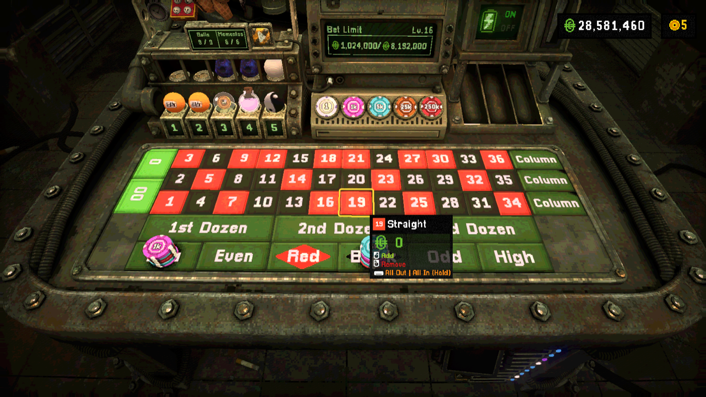
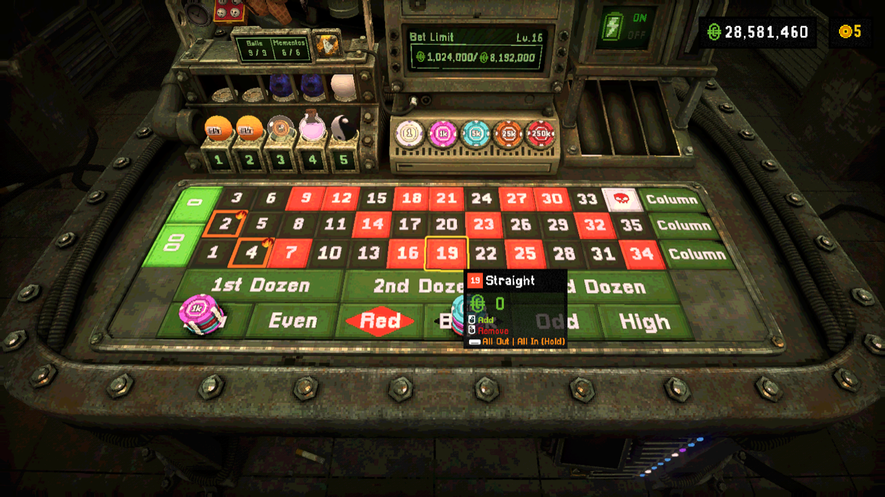
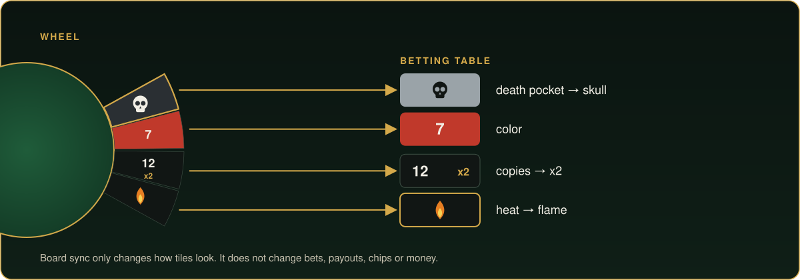
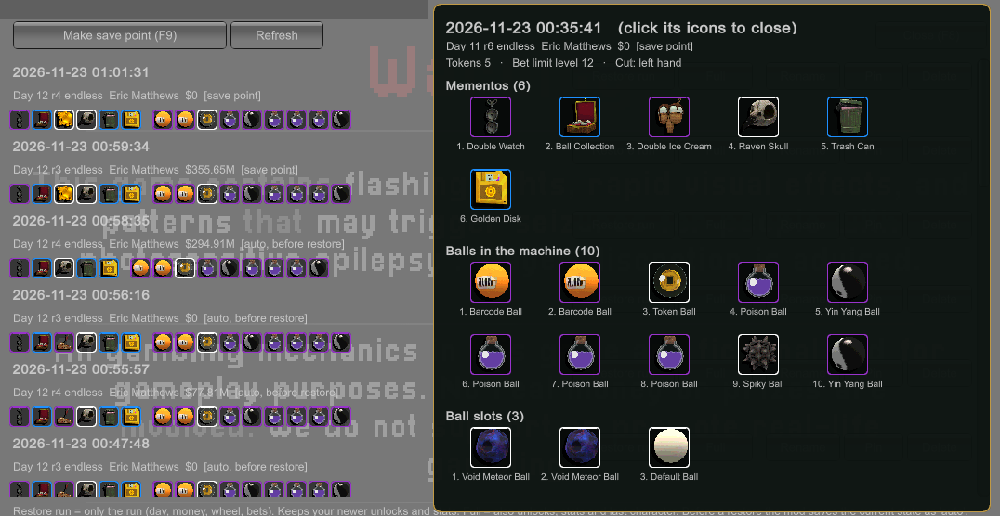
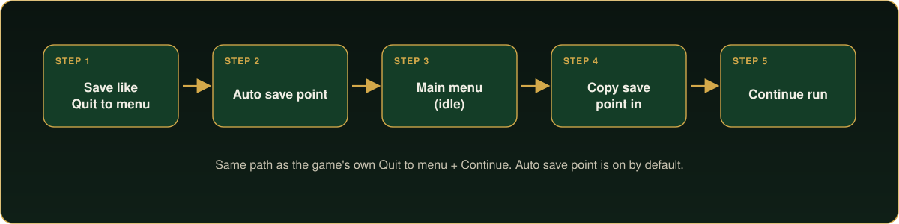

<div align="center">



<br/>

    [][wiki] [][thinkbot]

<br/>

**A mod for Trust Your Gut that makes the betting table show the wheel, and adds named save points you can restore.**

New to the game? The **[Trust Your Gut wiki][wiki]** has every ball, memento and offer, the board, and how to unlock characters and achievements.

_Unofficial fan mod. Not affiliated with Mishleto, the game's developer. No game files included._

How we built it: [the write-up on thinks.bot](https://thinks.bot/blog/trust-your-gut-mod-board-sync-save-points) · Entry: [thinks.bot/oss/trust-your-gut-mod](https://thinks.bot/oss/trust-your-gut-mod)

</div>

---

## What it does



- **Board sync.** The betting table copies the wheel. A death pocket shows a skull, and each tile takes its pocket's color.
- **Copies and fire marks.** A number shown by more than one pocket shows `x2`. Fire marks (for example Heat) show as small icons on the tile.
- **Moved numbers.** When no pocket shows a number any more (for example the 19 pocket became 18), its tile turns gray and shows `19 →18`. The game pays the tile of the number a pocket shows now, so a bet on a gray tile cannot win.
- **Save points.** Make one, see the list (day, round, character, chips, time), rename it, pin up to 4, or delete it. For strategy practice only: see [Leaderboards](#leaderboards-and-fair-play).
- **Item icons.** Each save point shows its mementos and balls as small icons, with the game's own pictures. Point at them to see every item in run order. Click them to keep the list open.
- **Restore.** Put back only the run, or the run with its unlocks and stats.
- **Undo a restore.** The mod makes an auto save point before each restore. This is on by default.
- **Safe by design.** Save points are exact copies. The mod never runs console commands and never edits a save file itself. Board sync never changes the odds.

## See it

| Before: board sync off | After: board sync on |
| --- | --- |
|  |  |



Board sync only changes how tiles look. It does not change bets, payouts, chips or money.

## Save points

> **Practice only.** Save points are for practicing strategy: try a risky bet, then go back and try another. A run you restore does not count for leaderboards or Steam achievements.

Open the save point window with the **Save points (mod)** button, or with F8. The button is at the top right of the main menu, the pause menu (Esc) and the death screen.

Making a save point copies the save files (`Save_Game.es3`, `Save_Persistent.es3`, `Save_CharacterSelect.es3`, `steam_autocloud.vdf`) to `~/tyg-backup/sp-<date>-<time>/`.

### Item icons



Each row shows the save point's mementos, a gap, then the balls in the order of the ball machine. Point at the icons to see the full list in run order:

- **Mementos**, **Balls in the machine** and **Ball slots**, numbered, with picture and name,
- tokens, bet limit level and cut body parts,
- consumables and starter items, if the run has any.

Click the icons to keep the list open at the right of the window. Click the list, or the icons again, to close it. The border color of an icon is the item's rarity color from the game.

What does an item do? Look it up in the [wiki][wiki]: every memento and ball has its card there, with its effect, rarity and where to get it.

### Restore



A restore does the same as "Quit to menu", then "Continue". The mod copies the files in while the menu is idle, then the game loads the run. A message at the top says "Restored: ..." when the game has loaded the restored file.

| Button | What it does |
| --- | --- |
| **Make save point** | Same as F9. In a run it first saves like "Quit to menu", so chips on the table are in the save point. |
| **Restore run** | Puts back only the run file (`Save_Game.es3`). |
| **Full** | Puts back the run, the unlocks and stats, and the last character. |
| **Rename** | Type a name of up to 60 characters, then press Enter or **Save**. Esc or **Cancel** stops. An empty name removes the name. |
| **Pin** / **Unpin** | Pin up to 4 save points, in slots 1 to 4. Pinned save points stay at the top of the list and cannot be deleted. |
| **Delete** | Asks "Sure?" and needs a second click. The folder moves to `~/tyg-backup/.trash/`. |

- Restore asks for a second click within 6 seconds.
- Buttons react on the next frame. A second click within 0.3 seconds counts as a double click and is ignored.
- The name is saved in `label.txt` and the pin slot in `pin.txt`. Both are in the save point folder.
- To get a deleted save point back, move its folder from `.trash` back into `~/tyg-backup/`. Finder hides folders whose name starts with a dot. Press Cmd+Shift+. in Finder to show them, or run `ls -a ~/tyg-backup`.
- While the window is open, the game's own menus get no clicks or keys. Close the window with its Close button or with F8.

### Hotkeys

| Key | What it does |
| --- | --- |
| F8 | Open or close the save point window. In a run it opens the pause menu under it. |
| F9 | Make a save point now, with no window. Not during a spin. |
| F7 | Turn board sync on or off. Off shows the game's normal board. |
| F6 | Proof: take a screenshot with board sync off, then one with it on. Saved to `~/tyg-backup/board-proof/`. |

> **Mac keyboards:** F6 to F9 are media keys (F8 is play/pause). Hold **fn** to send F8 or F9 to the game: `fn+F8`, `fn+F9`. You can set other keys in `TygMod.cfg`, section `Hotkeys`.

## Install

You need a Mac with CrossOver, `python3` (it comes with the Xcode command line tools), and Trust Your Gut from Steam in a CrossOver bottle named `Steam`. For another bottle name, run the scripts with `BOTTLE=<name>`.

The game must be closed. Quit it from its menu. Do not force-quit it.

Back up your saves first. Copy this folder to a safe place:
`~/Library/Application Support/CrossOver/Bottles/Steam/drive_c/users/crossover/AppData/LocalLow/Mishleto/Trust Your Gut`

**From a release (no build).** On [Releases](https://github.com/ThinkBotHQ/trust-your-gut-mod/releases), download `trust-your-gut-mod-1.3.1.zip` (not "Source code", which has no built mod) and unzip it. Then go into its `mod` folder and run the installer:

```bash
cd trust-your-gut-mod-1.3.1/mod
```

```bash
./install.sh
```

**From source.** The build needs the .NET SDK (for the C# compiler) and the game installed, because the mod compiles against the game's own DLLs:

```bash
git clone https://github.com/ThinkBotHQ/trust-your-gut-mod.git
```

```bash
cd trust-your-gut-mod/mod
```

```bash
./build.sh
```

```bash
./install.sh
```

`install.sh` does this:

- removes `BepInEx/plugins/TygMod.dll` from an older BepInEx install of this mod, if there is one. Other BepInEx files stay. Empty folders are removed.
- copies the Doorstop 4 loader (`winhttp.dll`, `.doorstop_version`) from `vendor/` into the game folder,
- writes `doorstop_config.ini` with `target_assembly=TygMod\TygMod.dll`,
- copies `bin/TygMod.dll` to `<game>/TygMod/`,
- writes `<game>/TygMod/TygMod.cfg` with `BackupFolder = Z:\Users\<you>\tyg-backup`, only if no config is there,
- sets the Wine DLL override `winhttp = native,builtin` for `Trust Your Gut.exe` only. Steam and other games are not changed.

### Check it works

Start the game from Steam, then read the log:

```bash
cat "$HOME/Library/Application Support/CrossOver/Bottles/Steam/drive_c/Program Files (x86)/Steam/steamapps/common/Trust Your Gut/TygMod/TygMod.log"
```

Good lines: `started by Doorstop`, `Game code loaded`, and `TYG mod 1.3.1 ready`. In a run you also see `Board found: <n> number tiles` and `Wheel state: ...`. The same lines go to the game's `Player.log` with a `[TygMod]` prefix.

### Turn the mod off for one start

Set `enabled = false` in `<game>/doorstop_config.ini`. The game then starts with no mod. Set it back to `true` to turn the mod on.

## Uninstall

The game must be closed.

Go into the `mod` folder (of the release zip or of your clone) and run:

```bash
./uninstall.sh
```

It removes `winhttp.dll`, `doorstop_config.ini`, `.doorstop_version`, the `TygMod` folder and the per-game DLL override. It does not touch your saves or `~/tyg-backup`.

To do it by hand, delete those three files and the `TygMod` folder from the game folder. Then run:

```bash
"/Applications/CrossOver.app/Contents/SharedSupport/CrossOver/bin/wine" --bottle Steam reg delete 'HKCU\Software\Wine\AppDefaults\Trust Your Gut.exe\DllOverrides' /v winhttp /f
```

## Leaderboards and fair play

- **Board sync** only changes how the tiles look. It does not mark the run or change any game value.
- **Save points are for strategy practice only.** Making a save point does not change your run. A run you restore does not count for leaderboards or Steam achievements.

The mod also:

- never runs console commands and never calls cheat code,
- never writes a money, chip or score value,
- never edits a save file itself. Save points are byte-for-byte copies, checked with SHA-256. To list them, the mod decrypts a save only to read the day, round, character and chips. It uses the game's own save settings for this, so no save key is in the mod,
- saves only with the game's own save calls, the same ones the game uses when its window loses focus and on "Quit to menu".

Want to know how the board, showdowns and endless days work? The [wiki][wiki] explains them with numbers from the game files.

<details>
<summary><b>Settings</b></summary>

File: `<game>/TygMod/TygMod.cfg`. It is written on the first start. Edit it with the game closed.

| Section | Key | Default | Meaning |
| --- | --- | --- | --- |
| BoardSync | Enabled | true | Board sync on at start. |
| BoardSync | ShowSkulls | true | Skull on death tiles. |
| BoardSync | ShowModifierIcons | true | Fire mark icons on tiles. |
| BoardSync | ShowCopyCount | true | `x2` on numbers shown by more than one pocket. |
| BoardSync | ProofFolder | (empty) | Empty means `<BackupFolder>\board-proof`. |
| Hotkeys | BoardToggle / ProofCapture / SaveWindow / QuickSavePoint | F7 / F6 / F8 / F9 | Key names as in Unity `Key` (F1..F12, Home, ...). |
| SavePoints | BackupFolder | (empty) | Windows path for save points. Empty means your home `tyg-backup`. Backslashes are fine. |
| SavePoints | AutoSavePointBeforeRestore | true | Make an `auto-...` save point before each restore. |
| SavePoints | UiScale | 0 | Window size. 0 means auto from screen height. |
| Debug | CommandFile | false | Test hook. See "Test hook" below. Keep it `false`. |

</details>

<details>
<summary><b>Known limits</b></summary>

- Log files (`Player.log`) are not copied into save points.
- A save point holds what the game writes on "Quit to menu" at that moment. The mod starts that same save first. Up to version 1.1.0 the mod wrote only the game's pending saves. The game does not ask for a save when you place chips, so save points made after betting held the run from before the bets. This is fixed in 1.2.0. To check an old save point, look at its cash in the list: chips on the table lower the cash.
- No save point and no restore during a spin. The mod asks you to wait.
- "Full" restore: if a game object writes unlocks or stats while the main menu is idle, one value can be newer than the save point. Tested: after a Full restore, the unlocks file had the same content as the save point.
- A save point that the mod cannot read (damaged file) shows "cannot read: no restore".
- The F8 window cannot open while the game blocks its own pause menu (death screen animation, end of game, elevator ride, collar and ladder sequences). F9 and restores are refused there too ("No save point during ..."). On the death screen the window opens, so you can restore after a death.
- A number shown by more than one pocket uses the look of its own pocket, or of the first one that is not death. The `xN` count and the icons still show all of them.
- Board sync covers the straight number tiles. Red/black, even/odd, dozens and columns keep the game's normal look.
- Save points made by an older game version may not load after a game update.
- `TygMod.cfg` is written again on each start. Keys or comments you add by hand are dropped. Change only the values.
- The rename field is drawn by the mod, because this game's Unity has no text box. It types at the end only: no cursor moves, no paste. While you type, A/D and the left/right arrow keys also move the highlight in the game's bet list on the pause menu under the window. Only what it shows changes. Nothing in the run changes.
- Item names and pictures come from the game's own item lists. An item the game has not loaded shows two letters instead of a picture. Names are in the game's language, so they can differ from the ids in the save file (for example the save id `Shopaholic Ball` shows as "Barcode Ball").
- The skull and icon overlays are placed when a tile changes. The table does not move in this game. If a future update moves it, the overlays can be out of place until the next wheel change.

</details>

<details>
<summary><b>Test hook (for testing only)</b></summary>

Wine gives the game window no Mac app id, so test tools cannot click in it. For tests, set `CommandFile = true` in section `[Debug]` of `TygMod.cfg`. The mod then reads `<game>/TygMod/TygMod.cmd` about once a second, deletes it, and runs each line:

- `savepoint`, `open`, `close`, `list`
- `restore <save point folder> run|full`
- `rename <save point folder> <name>`
- `pin <save point folder>`, `unpin <save point folder>`
- `delete <save point folder>` (no second click)
- `details <save point folder>` (keep its item list open; no folder = close it)
- `proof`, `shot <name>`

These start the same code as the hotkeys and buttons. Results go to `TygMod.log`. Set `CommandFile` back to `false` after the test.

</details>

<details>
<summary><b>Files</b></summary>

| Path | What |
| --- | --- |
| `mod/src/Entrypoint.cs` | Doorstop entry: waits for the game code and the first scene, then starts the mod. |
| `mod/src/ModCore.cs` | Log file and settings file. |
| `mod/src/Plugin.cs` | Settings and start-up. |
| `mod/src/BoardSync.cs` | Reads the wheel, paints the tiles, F6/F7. |
| `mod/src/SaveGate.cs` | Calls into the game's SaveManager: save like Quit to menu, reset pending state before a restore. |
| `mod/src/SavePointStore.cs` | Make, list, read and restore save points. |
| `mod/src/RestoreMark.cs` | Marks a run restored from a save point with the game's own flag, so it does not count for leaderboards or achievements. |
| `mod/src/SavePointMeta.cs` | Name, pin and delete. Plain .NET, tested by `tools/meta-test/run.sh`. |
| `mod/src/SaveDetails.cs` | Reads the item lists, tokens, bet limit level and cut body parts from a save. Plain .NET, tested by `tools/meta-test/run.sh`. |
| `mod/src/ItemIcons.cs` | Item names, pictures and rarity colors from the game's own item lists. Read only. |
| `mod/src/SavePointUI.cs` | F8 window, F9, toasts, restore flow, item icons and the item list. |
| `mod/src/Keys.cs` | Hotkeys (new Input System, old Input as fallback). |
| `mod/src/TestCommands.cs` | Test hook (off by default). |
| `mod/build.sh` | Compiles `mod/bin/TygMod.dll` against the game's own DLLs. |
| `mod/install.sh` / `mod/uninstall.sh` | Put the mod in and take it out. |
| `tools/meta-test/run.sh` | Offline tests for `SavePointMeta.cs` and `SaveDetails.cs`. |
| `tools/taint_check.sh`, `tools/es3_read.py` | Read-only checks of a copy of a save file. |
| `vendor/` | The Doorstop loader. See `vendor/README.md`. |

**Save key not included.** The tools that decrypt a save copy need the game's save key. It is not in this repo. Set `TYG_SAVE_KEY`, or put the key on one line in `tools/.save-key` (git ignores this file). Without it, `run.sh` runs only its fixed test cases. The mod itself needs no key.

</details>

<details>
<summary><b>Why no BepInEx</b></summary>

This game ships a stripped .NET runtime. BepInEx 5 stops at start-up (`Module.GetPEKind` is missing). The "unstripped corlibs" from unity.bepinex.dev for 6000.0.62 are a Linux build. On Windows and Wine they break file access, and the main menu hangs.

So the mod uses only the small Doorstop loader (`winhttp.dll`), starts itself, and uses plain reflection instead of Harmony. It is compiled against the game's own stripped DLLs, so every call it makes exists in this game.

</details>

## License and legal

- The mod code is MIT licensed. See [LICENSE](LICENSE).
- `vendor/bepinex-5.4.23.6/` holds the Unity Doorstop 4.6.0 loader, not changed. It is LGPL-2.1. See [its license text](vendor/bepinex-5.4.23.6/LICENSE-LGPL-2.1.txt) and [vendor/README.md](vendor/README.md) for its source.
- This is an unofficial fan mod. It is not affiliated with or endorsed by Mishleto (the game's developer) or Valve. Trust Your Gut, its name and its art belong to their owners. The screenshots show the game only to explain the mod.
- No game files are included. While the game runs, the mod uses the game's own code and pictures on your computer.
- For single-player use. Save points are for practice. A restored run does not count for leaderboards or Steam achievements.

## Wiki

Our Trust Your Gut wiki is coming soon: every ball, memento and offer, the board, characters and achievements. The link will be here.

---

<div align="center">

**[Trust Your Gut wiki][wiki]**

Made by [ThinkBot](https://thinks.bot), a US-led senior software pod. More open source and fair source: [thinks.bot/oss](https://thinks.bot/oss).

<sub>Made for Steam app 4066520 (Unity 6000.0.62, build 26799649) in a CrossOver bottle named `Steam` on a Mac. Save points made by an older game version may not load after a game update.</sub>

</div>

<!-- Links. The wiki is not public yet, so [wiki] jumps to the Wiki section above.
     When it is live, set its URL once here (every [wiki] link in this file uses it) and remove that section. -->
[wiki]: #wiki
[thinkbot]: https://thinks.bot
